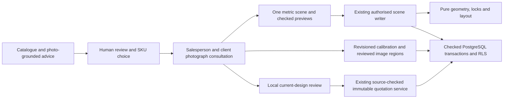
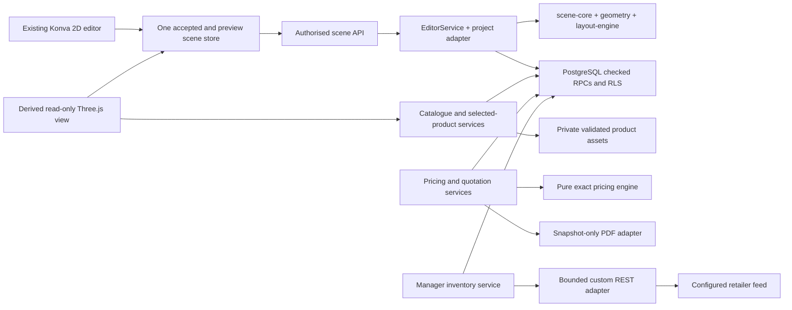
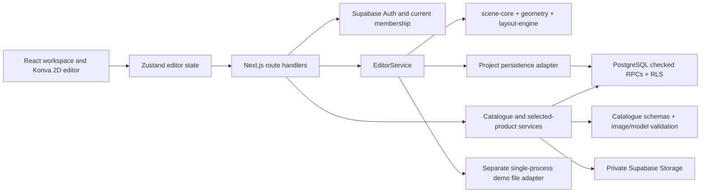
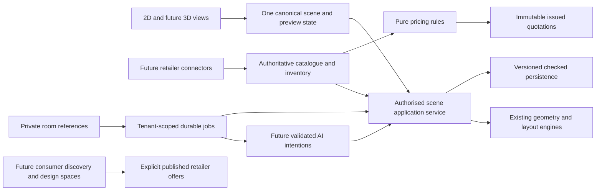

# RoomSell architecture alignment audit

## Actual photograph composition architecture — 17 October 2026

The existing modular monolith remains: Next.js, Supabase and pure scene/geometry/layout/catalogue/pricing packages. The retailer UI composes image pixels in Canvas 2D, with no WebGL or 3D furniture viewer. The metric scene is internal authority for fit, independent locks, versioned operations and SKU references. Legacy demo/personal-room adapters are separate.

`photo_workspaces` owns reviewed regions, calibration and cleanup background. New `photo_compositions` owns bounded per-object image layers/masks, scene/photo source revisions, rendered private PNG/hash and staff confirmation. `photo-composition-service.ts` validates input/access and invokes service-only transactional RPCs. `photo-composition-jobs.ts` rechecks actor and source revisions, downloads only selected-project assets and uses `photo-composition-renderer.ts`. The renderer shares alpha-mask logic with the browser; rugs use inverse floor projection and tall images preserve their supplied aspect ratio. Optional AI lighting is bounded; original product pixels are reinserted after it. Job retries recover staged bytes without overwriting a final reference.

Quotation preview/issue carries exact image proof. `issue_photo_quotation` and the quotation trigger validate current confirmed composition within the existing organisation lock, then preserve the existing stock/pricing transaction. `quotation_photo_evidence` prevents source/final reference deletion while an issued quote retains them. PDF export verifies the stored PNG hash before embedding it. Migrations 020–022 are forward-only and preserve prior scenes.

This approved implementation is ADR-007. Automatic depth reconstruction, invented product views and exact visual fit from one photo remain outside the contract. Source photographs and catalogue identities are retained. The historical target descriptions below are not evidence of current implementation; current workflow is [PHOTO_SELLING.md](PHOTO_SELLING.md).

## Current architecture — salesperson photograph consultation

The latest confirmed product flow removes the visible 2D section. `project-editor.tsx` presents a photo-only retailer consultation; `editor.tsx` uses `photo-studio.tsx` for retailer projects and the 3D viewer for legacy demo/personal rooms. The old Konva adapter is not mounted. No scene conversion, new dependency, database migration or replacement application is needed. Historical keep-2D decisions below describe earlier scope and are superseded for the user interface.

`photo-consultation.tsx` owns the guided steps and local client review. `PhotoConsultationStatus` communicates selected private reference, photo revision, calibration and image readiness to the assistant and quotation review. The confirmation binds the current scene/photo and loaded chosen-product summary; relevant changes or reload invalidate it. This is a salesperson checklist, not a persisted customer signature or an additional server permission model. Existing quotation history stays readable, and backend issuance remains governed by current source/version, permissions, stock and immutable exact pricing.

AI recommendations can propose authorised catalogue additions, checked catalogue-object removals and keep/remove actions for known reviewed photo regions. `project-assistant.tsx` routes a chosen variant to photo click placement. Scene previews and image cleanup retain independent human acceptance. Inferred labels/rectangles never become metric furniture or obstacles automatically.

The secure custom REST inventory/supplier boundaries are unchanged. Actual retailer credentials/contract, live OpenAI quality and physical room acceptance remain external gates. Current walkthrough and limits: [PHOTO_SELLING.md](PHOTO_SELLING.md). Executed results: [VALIDATION.md](VALIDATION.md).

## Earlier calibrated photograph view increment — historical

The approved photo-first workflow adds `photo-studio.tsx` as another adapter over the existing scene/store. `geometry/photo-calibration.ts` recovers a metric pinhole camera from four confirmed floor correspondences; the same `Furniture3D`/safe model loader renders original-size catalogue meshes over the private photograph. Local dragging uses the grabbed point's horizontal plane, pure checked proposals and the ordinary server preview/accept path. It never creates a second scene authority or calls AI on pointer movement.

`photo-service.ts` and migration 019 persist separately revisioned calibration, reviewed image regions and the chosen background. `photo-jobs-service.ts` uses the existing durable queue for schema-validated vision and selected-area image edits through `photo-provider.ts`. Only a completed cleanup of the exact source revision can be applied; only reviewed pixels are composited, and the original reference remains unchanged. All reads remain project-scoped. Existing AI hourly quotas include these jobs. No dependencies were added. See [PHOTO_SELLING.md](PHOTO_SELLING.md) for the workflow, limitations and live-provider acceptance boundary.

## Earlier six-area application implementation — historical checkpoint

The existing modular monolith, 2D editor and scene v2 are preserved. No dependencies were added in this increment. The earlier audit and steps 1–4 checkpoint below remain historical evidence.

Actual additions are project-private references (`room-reference-service.ts`); durable leased jobs (`jobs-service.ts`, `worker-service.ts`); strict catalogue/budget advice (`assistant-contract.ts`, `ai-provider.ts`, `design-assistant-service.ts`); checked reservations/orders (`order-service.ts`); and explicitly published offers plus separately owned consumer projects (`marketplace-service.ts`). These paths are under `apps/web/lib`. Migrations 011–016 define their database authority and RLS.

AI workers use the same `projectEditor`/`EditorService` preview path as a human. They never accept scenes. Prices, stock, permissions, scene versions and locks are independently checked. Recommendations are estimates; an issued quotation remains the authoritative immutable commercial document.

Consumer designs use scene v2 with `organisationId: consumer:<auth-user-id>` and a separate owned persistence adapter. Retailer `organisationId` is still mandatory and unchanged. Both renderers and the existing editor operate on this same scene. Consumer 3D currently uses measured proxies. Only selected published product images have a public delivery route; private catalogue and room-reference buckets stay private. A consented enquiry copies only the selected retailer's objects into a new retailer project.

Operational implementation includes database health checks, authenticated cron execution, safe hosted cookie/origin configuration, a Vercel deployment configuration and verified local database-plus-asset backup/restore scripts. Vercel/Supabase projects, live OpenAI, SMTP delivery, hosted monitoring and hosted restoration have not been provisioned or verified. The target remains managed hosting; see [DEPLOYMENT.md](DEPLOYMENT.md).

Boreal Living is an explicitly fictional, local-only fixture with generated photographs and isolated accounts. Its simulated feed reconciles fulfilled quantities. Real snapshot-only connectors cannot fulfil externally managed stock until an upstream order acknowledgement adapter exists; migration 015 fails closed. No external POS order, payment, shipment, billing or notification is implied.

## Approved implementation checkpoint — historical, 14 October 2026

The user approved implementation after the audit. The existing 2D editor, canonical schema v2 and one Next.js application remain in place. The historical audit against `660d52f887eb396506e76401145ee99e0a93de8d` is preserved below; statements in that snapshot describe the baseline, not the new implementation. Full combined build/database/browser gates are pending at the time of this update; current verification belongs in `VALIDATION.md`.

### Actual architecture after alignment

The modular monolith now has seven capability packages: scene-core, geometry, layout-engine, catalogue, ui, pricing and inventory. Pricing isolates actual shared financial calculations; inventory isolates the actual external-feed contract and transport boundary. Neither package changes the 2D editor or introduces another application.

- `scripts/runtime-target.mjs` owns exclusive local/hosted Supabase selection and local test preflight. Local mode uses only verified loopback status; test setup refuses hosted bindings before writes. `supabase-config.ts` delegates to this policy.
- `demo-policy.ts` requires `ROOMSELL_ENABLE_DEMO=1` for the demo page, scene APIs and file adapter. Disabled deployments return 404. The existing shared demo remains explicitly opt-in and single-process. HTTP JSON parsing is bounded and shared.
- `editor-service.ts` persists solver compatibility, base-scene SHA-256 and approved-result SHA-256 in server-owned preview envelopes. Acceptance validates those values and compares deterministic recomputation before writing. Legacy/incompatible previews fail with 409; accepted scene data does not change format.
- `packages/catalogue/src/policy.ts`, `money.ts`, `models.ts` and `asset-policy.ts` supply shared DTOs, exact identity/availability predicates, null-preserving totals, exact currency formatting, matching-model resolution and byte/tolerance constants. SQL catalogue admission remains independent under the organisation lock.
- `packages/geometry/src/render-contract.ts` supplies right-handed scene transforms, Konva yaw conversion, plan coordinate round trips and floor-centre model offsets. `room-viewer-3d.tsx` derives the accepted or preview scene; `3d-model-runtime.ts` loads only authorised project assets, rejects external model resources, remeasures actual geometry and releases resources. Missing, stale, incompatible, over-budget or failed models use labelled dimension proxies. Meshes retain measured dimensions within documented export tolerance; no silent scale is applied. WebGL failure leaves the working 2D view available.
- `packages/pricing/src/index.ts` computes explicitly supplied retailer rules using BigInt, half-up rounding and stable allocations. `quotation-service.ts` obtains current authorised source data, computes prices and binds issuance to a reviewed source fingerprint. `quotation-schemas.ts` verifies snapshot consistency; `quotation-pdf.ts` renders saved snapshots, not current catalogue prices.
- `packages/inventory` implements one real custom REST feed contract, external/internal mappings, bounded freshness/replay checks, authenticated HTTPS transport and encrypted credentials. `inventory-service.ts` orchestrates manager-only manual sync. Migration 009 applies complete mapped snapshots atomically, serialises with scene/catalogue writes, records sanitised outcomes and preserves physical scene/catalogue identities.

### Authority and operational limits

Scene commits continue through the existing domain validation/persistence path. Quotations and connector reconciliation have separate checked SQL transactions: they do not submit replacement scenes. Issued quotes snapshot retailer/customer/project/source/policy/calculation and explicitly declare `inventoryReserved: false`. Placement still checks per-variant availability; quote issuance checks aggregate selected quantities without creating reservations.

The current connector needs an actual retailer endpoint and credentials matching the documented contract. Its full mapped feed is limited to 1 MiB/1,000 items, rejects snapshots over 15 minutes old, and requires all mappings exactly once. Public HTTPS transport uses pinned validated DNS addresses with 5-second DNS/15-second total limits. Connector credentials require `ROOMSELL_CONNECTOR_ENCRYPTION_KEY`; no credentials are returned to clients. It is not an integration with every POS/ERP vendor. Sync is manual and synchronous; there is no scheduler, durable job worker or reservation/order pipeline. Hosted operations, email confirmation/proxy trust, backups and production limits still need staging verification. PDF standard-font coverage is limited and replacement characters are disclosed; original snapshot text remains intact.

### Remaining proposed target architecture

AI recommendation/intention adapters, private room-reference photographs, durable jobs and consumer marketplace ownership/publication remain future work. They must use the existing scene preview/commit and authorised catalogue boundaries. A worker should be added for a real durable processing need; its scene writer must reuse domain validation. No separate scene engine, weakened tenant scope or editor rewrite is proposed.

## Baseline audit snapshot — historical

Audited 14 October 2026, against commit `660d52f887eb396506e76401145ee99e0a93de8d`. This audit changes documentation only. Application code, schemas, dependencies and working 2D behaviour remain unchanged. Proposed changes require approval.

### Actual architecture

The repository is already a TypeScript npm workspace with one Next.js application and five small packages. Keep this arrangement; creating another application or replacing the editor is unnecessary.

#### Modules and authority

- `packages/scene-core/src/index.ts` defines strict scene schema v2, v1 migration, operations, relationships and exact lock comparisons. Coordinates and dimensions are metres; rotation is radians about +Y.
- `packages/geometry/src/index.ts` contains pure oriented footprints, SAT collision tests, wall/ceiling checks, opening envelopes, distance guides and wall snapping.
- `packages/layout-engine/src/index.ts` contains pure deterministic manual and bounded Smart rearrangement, rigid groups and soft followers. It has no provider, network, React or pricing dependency.
- `apps/web/components/floor-plan.tsx` draws the scene and converts pointer/display coordinates. `editor.tsx` provides controls. `apps/web/lib/editor-store.ts` owns accepted/preview state and request-generation protection.
- `apps/web/lib/editor-service.ts` orchestrates preview, recomputation, locks, validation, accept and undo/redo through a persistence port. It is dependency-light TypeScript but currently lives inside the web app and uses Node crypto.
- `apps/web/lib/project-service.ts` supplies verified project access, catalogue-add checks and request-scoped Supabase persistence. `local-persistence.ts` supplies the separate demo adapter.
- `apps/web/lib/catalogue-service.ts`, `project-catalogue.ts` and `packages/catalogue` implement retailer records, bounded imports, validated assets and live selected-product prices.

#### Actual edit transaction

1. A client submits an operation and expected scene version, not a replacement scene.
2. Project routes authenticate through `auth.getUser()` and check current membership/project access.
3. Scene schemas, catalogue identity checks and the layout engine validate a preview. The accepted scene remains unchanged.
4. Acceptance loads the actor's saved preview, repeats catalogue checks and recomputes the operation.
5. The domain service checks locks, identity/dimensions and geometry before persistence.
6. PostgreSQL `commit_scene` locks the organisation and scene, repeats edit authority and version checks, and checks new catalogue-object metadata under the catalogue write lock.
7. One transaction stores the new scene, room projection, version/audit rows and undo/redo stacks, and removes obsolete previews.

The service-role client is a trusted server boundary. SQL does not independently implement all geometry or lock rules. Authenticated users cannot invoke the service-only scene commit directly. Future workers must use the same validated orchestration rather than bypassing it with arbitrary scene JSON.

#### Actual persistence and security

Project scene JSON is authoritative; scalar room columns are a transactional projection. Undo/redo restores complete snapshots, including locks, while increasing the current version. Stacks are bounded at 100 each; the API returns 100 revisions. Database history rows persist separately. Project previews are actor-scoped and expire after 15 minutes. The demo adapter has one process-local queue and in-memory previews; it is not a multi-server datastore.

Auth uses request-scoped SSR clients and HttpOnly, SameSite=Lax cookies. Secure cookies depend on a trusted HTTPS forwarding header. RLS, explicit grants and composite tenant foreign keys protect relational records. Role/access revocation serialises with sensitive organisation transactions. Customer contact records do not confer account access; customer members receive explicit project grants.

There are seven SQL migrations under `supabase/migrations`. Product/variant writes and imports are atomic service-only RPCs with actor rechecks. Assets are validated before private storage, then registered with authority/dimension checks. Application asset routes recheck access; project customers receive only selected-product assets.

The local runtime has a confirmed configuration ambiguity: `supabase-config.ts` reads local status when the local flag is set, but still prefers separately supplied hosted environment bindings. See risk R1. The existing claim that a local flag alone forces test isolation is therefore too strong.

#### Features that are absent

No 3D renderer, AI provider/intention adapter, inventory connector, reservation system, room-reference-photo domain, issued quotation/PDF engine, durable job infrastructure or consumer marketplace exists in the audited application. Validated model uploads currently provide downloads. Smart rearrangement is deterministic search. Budget UI is a current catalogue subtotal, without taxes, discounts or immutable quotation pricing.

### Proposed target architecture — not implemented

Retain a modular monolith: the existing Next.js app, pure scene/geometry/layout packages, PostgreSQL/Auth and private storage. Add modules only for concrete capabilities and add a worker only when durable processing is required. Initial 3D needs no scene rewrite: render the same accepted or preview scene through a second adapter.

- **Scene/rendering:** preserve v2 metre coordinates, ground-centred pivots and rotation semantics. 3D meshes/proxies are derived views, never a second editable source of truth.
- **Catalogue/inventory:** keep internal UUIDs stable; introduce provider-scoped external IDs, freshness, reconciliation and idempotent ingestion. Quantity/reservation policy belongs here, not in renderers.
- **Pricing/quotations:** use exact minor-unit arithmetic and explicit retailer tax/discount/delivery rules. Persist issued item/pricing snapshots separately from mutable catalogue prices and scene undo history.
- **AI/photos:** store references with project-scoped access. AI proposes validated intents against real authorised candidates. It cannot invent SKUs, dimensions, prices, locks or trusted room measurements. Human approval uses the ordinary scene preview/commit path.
- **Jobs:** queue records carry tenant/project/actor identity, idempotency and retry state. Recheck permissions and versions at execution/commit. Extract shared scene orchestration only when a second backend consumer exists; keep the editor unchanged.
- **Marketplace:** introduce explicit consumer ownership and retailer publication permissions. Do not make existing tenant fields optional or weaken private catalogue RLS.

Read [CURRENT_STATE.md](CURRENT_STATE.md) for evidence, [SCENE_CONTRACT.md](SCENE_CONTRACT.md) and [INVARIANTS.md](INVARIANTS.md) for contracts, [MODULE_OWNERSHIP.md](MODULE_OWNERSHIP.md) for boundaries, [ARCHITECTURE_RISKS.md](ARCHITECTURE_RISKS.md) for risk severity, and [ALIGNMENT_PLAN.md](ALIGNMENT_PLAN.md) for sequenced tasks. Major choices are proposals in [ARCHITECTURE_DECISIONS.md](ARCHITECTURE_DECISIONS.md), not approved implementations.
